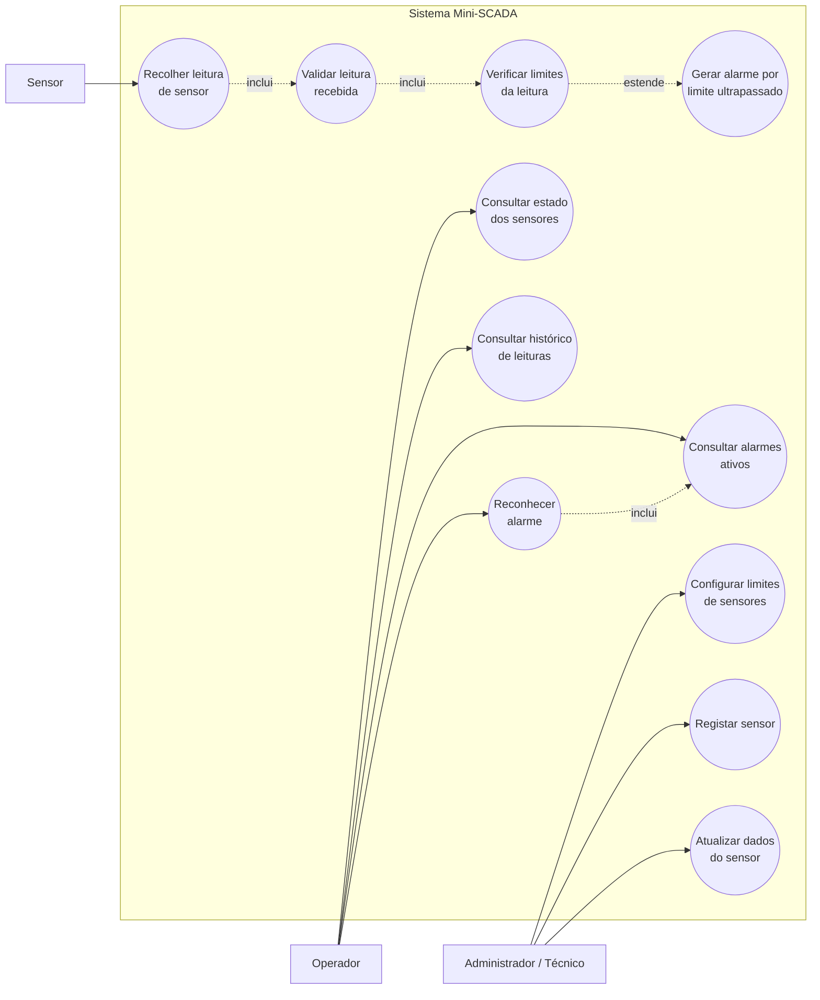

# Casos de Uso — Mini-SCADA

O sistema **Mini-SCADA** tem como objetivo recolher leituras de sensores, validar os dados recebidos, verificar se os valores ultrapassam limites definidos e gerar alarmes automaticamente.  
O operador pode consultar sensores, leituras e alarmes, enquanto o administrador/técnico gere sensores e configura limites.

---

## Diagrama de casos de uso



---

## Atores

| Ator | Descrição |
|---|---|
| Sensor | Dispositivo responsável por enviar leituras para o sistema Mini-SCADA. |
| Operador | Utilizador que consulta sensores, leituras e alarmes, podendo também reconhecer alarmes. |
| Administrador / Técnico | Utilizador responsável por configurar limites, registar sensores e atualizar dados técnicos dos sensores. |

---

# CU01 — Recolher leitura de sensor

| Campo | Descrição |
|---|---|
| Ator principal | Sensor |
| Objetivo | Permitir que o sistema receba uma leitura enviada por um sensor. |
| Pré-condições | O sensor está registado no sistema e encontra-se ativo. |
| Pós-condições | A leitura fica registada no sistema. |
| Fluxo principal | 1. O sensor envia uma leitura ao sistema;<br>2. O sistema identifica o sensor;<br>3. O sistema valida o formato da leitura;<br>4. O sistema guarda a leitura com data e hora;<br>5. O sistema confirma a receção da leitura. |
| Fluxos alternativos | 2A. Caso o sensor não exista, o sistema rejeita a leitura;<br>3A. Caso a leitura tenha formato inválido, o sistema rejeita a leitura e regista o erro. |
| Requisitos relacionados | Tempo de resposta, fiabilidade e validação de dados. |

---

# CI01 — Validar leitura recebida

| Campo | Descrição |
|---|---|
| Ator principal | Caso incluído no CU01 |
| Objetivo | Garantir que a leitura recebida é válida antes de ser processada. |
| Pré-condições | O sistema recebeu uma leitura de um sensor. |
| Pós-condições | A leitura é aceite ou rejeitada. |
| Fluxo principal | 1. O sistema recebe a leitura;<br>2. O sistema verifica se o valor da leitura é válido;<br>3. O sistema verifica se a unidade da leitura é válida;<br>4. O sistema verifica se a data e hora são válidas;<br>5. O sistema marca a leitura como válida. |
| Fluxos alternativos | 2A. Caso o valor seja inválido, o sistema rejeita a leitura;<br>3A. Caso a unidade seja inválida, o sistema rejeita a leitura;<br>4A. Caso a data ou hora esteja incorreta, o sistema rejeita a leitura. |
| Requisitos relacionados | Fiabilidade, integridade dos dados e validação de dados. |

---

# CI02 — Verificar limites da leitura

| Campo | Descrição |
|---|---|
| Ator principal | Caso incluído no CI01 |
| Objetivo | Comparar a leitura recebida com os limites definidos para o sensor. |
| Pré-condições | A leitura foi validada com sucesso. |
| Pós-condições | O sistema determina se a leitura está dentro ou fora dos limites permitidos. |
| Fluxo principal | 1. O sistema obtém a leitura validada;<br>2. O sistema consulta os limites configurados para o sensor;<br>3. O sistema compara o valor da leitura com o limite mínimo e o limite máximo;<br>4. O sistema classifica a leitura como normal ou fora dos limites. |
| Fluxos alternativos | 2A. Caso não existam limites definidos, o sistema regista apenas a leitura;<br>3A. Caso a leitura esteja abaixo do limite mínimo, o sistema prepara a criação de um alarme;<br>3B. Caso a leitura esteja acima do limite máximo, o sistema prepara a criação de um alarme. |
| Requisitos relacionados | Tempo de resposta, fiabilidade e desempenho. |

---

# CI03 — Gerar alarme por limite ultrapassado

| Campo | Descrição |
|---|---|
| Ator principal | Caso de extensão do CI02 |
| Objetivo | Criar automaticamente um alarme quando uma leitura ultrapassa os limites definidos. |
| Pré-condições | Existe uma leitura válida fora dos limites permitidos. |
| Pós-condições | Um alarme fica registado e disponível para consulta pelo operador. |
| Fluxo principal | 1. O sistema deteta que a leitura está fora dos limites;<br>2. O sistema identifica o sensor associado à leitura;<br>3. O sistema cria um alarme com estado “ativo”;<br>4. O sistema associa o alarme à leitura que o originou;<br>5. O sistema disponibiliza o alarme para consulta pelo operador. |
| Fluxos alternativos | 3A. Caso já exista um alarme ativo para o mesmo sensor, o sistema atualiza o alarme existente;<br>5A. Caso a interface esteja indisponível, o alarme fica registado para visualização posterior. |
| Requisitos relacionados | Tempo de resposta, fiabilidade e rastreabilidade. |

---

# CU02 — Consultar estado dos sensores

| Campo | Descrição |
|---|---|
| Ator principal | Operador |
| Objetivo | Permitir ao operador verificar o estado atual dos sensores. |
| Pré-condições | Existem sensores registados no sistema. |
| Pós-condições | O operador visualiza o estado dos sensores. |
| Fluxo principal | 1. O operador acede à área de sensores;<br>2. O sistema apresenta a lista de sensores registados;<br>3. O operador seleciona um sensor;<br>4. O sistema apresenta o estado atual do sensor, a última leitura recebida e a data/hora da última comunicação. |
| Fluxos alternativos | 2A. Caso não existam sensores registados, o sistema apresenta uma mensagem informativa;<br>4A. Caso o sensor esteja sem comunicação, o sistema apresenta o estado “inativo” ou “sem sinal”. |
| Requisitos relacionados | Tempo de resposta, disponibilidade e fiabilidade. |

---

# CU03 — Consultar histórico de leituras

| Campo | Descrição |
|---|---|
| Ator principal | Operador |
| Objetivo | Permitir ao operador consultar leituras anteriores dos sensores. |
| Pré-condições | Existem leituras registadas no sistema. |
| Pós-condições | O operador visualiza o histórico de leituras filtrado. |
| Fluxo principal | 1. O operador acede ao histórico de leituras;<br>2. O operador seleciona um sensor;<br>3. O operador define um intervalo de datas;<br>4. O sistema procura as leituras correspondentes;<br>5. O sistema apresenta os resultados encontrados. |
| Fluxos alternativos | 5A. Caso não existam leituras para os filtros escolhidos, o sistema apresenta uma mensagem informativa. |
| Requisitos relacionados | Desempenho, usabilidade e disponibilidade. |

---

# CU04 — Consultar alarmes ativos

| Campo | Descrição |
|---|---|
| Ator principal | Operador |
| Objetivo | Permitir ao operador visualizar os alarmes atualmente ativos. |
| Pré-condições | O operador tem acesso ao sistema. |
| Pós-condições | O operador visualiza a lista de alarmes ativos. |
| Fluxo principal | 1. O operador acede à área de alarmes;<br>2. O sistema apresenta os alarmes ativos;<br>3. O operador seleciona um alarme;<br>4. O sistema apresenta os detalhes do alarme, incluindo sensor, valor lido, limite ultrapassado, data, hora e estado. |
| Fluxos alternativos | 2A. Caso não existam alarmes ativos, o sistema apresenta uma mensagem informativa. |
| Requisitos relacionados | Usabilidade, tempo de resposta e disponibilidade. |

---

# CU05 — Reconhecer alarme

| Campo | Descrição |
|---|---|
| Ator principal | Operador |
| Objetivo | Permitir ao operador confirmar que tomou conhecimento de um alarme. |
| Pré-condições | Existe pelo menos um alarme ativo. |
| Pós-condições | O alarme fica marcado como reconhecido. |
| Fluxo principal | 1. O operador consulta a lista de alarmes ativos;<br>2. O operador seleciona um alarme;<br>3. O operador escolhe a opção “Reconhecer”;<br>4. O sistema regista o reconhecimento do alarme;<br>5. O sistema guarda a data, hora e utilizador responsável pelo reconhecimento;<br>6. O sistema altera o estado do alarme para “reconhecido”. |
| Fluxos alternativos | 3A. Caso o alarme já tenha sido reconhecido, o sistema informa o operador;<br>4A. Caso ocorra erro ao guardar, o sistema mantém o alarme ativo e apresenta uma mensagem de erro. |
| Requisitos relacionados | Fiabilidade, rastreabilidade e segurança. |

---

# CU06 — Configurar limites de sensores

| Campo | Descrição |
|---|---|
| Ator principal | Administrador / Técnico |
| Objetivo | Permitir definir ou alterar os limites mínimo e máximo de cada sensor. |
| Pré-condições | O administrador/técnico tem permissões para configurar sensores. |
| Pós-condições | Os novos limites ficam guardados e passam a ser usados nas próximas leituras. |
| Fluxo principal | 1. O administrador/técnico acede à área de configuração de sensores;<br>2. O administrador/técnico seleciona um sensor;<br>3. O administrador/técnico introduz o limite mínimo e o limite máximo;<br>4. O sistema valida os valores introduzidos;<br>5. O sistema guarda os novos limites. |
| Fluxos alternativos | 4A. Caso o limite mínimo seja superior ao limite máximo, o sistema rejeita a configuração;<br>4B. Caso algum valor esteja em falta, o sistema pede a correção dos dados. |
| Requisitos relacionados | Segurança, validação de dados e fiabilidade. |

---

# CU07 — Registar sensor

| Campo | Descrição |
|---|---|
| Ator principal | Administrador / Técnico |
| Objetivo | Permitir adicionar um novo sensor ao sistema. |
| Pré-condições | O administrador/técnico tem permissões para gerir sensores. |
| Pós-condições | O sensor fica registado e disponível para enviar leituras. |
| Fluxo principal | 1. O administrador/técnico acede à área de gestão de sensores;<br>2. O administrador/técnico escolhe a opção “Registar sensor”;<br>3. O administrador/técnico introduz os dados do sensor, como nome, tipo, localização e unidade de medida;<br>4. O sistema valida os dados introduzidos;<br>5. O sistema regista o sensor;<br>6. O sistema confirma o registo do sensor. |
| Fluxos alternativos | 4A. Caso existam dados inválidos, o sistema pede a correção;<br>5A. Caso já exista um sensor com a mesma identificação, o sistema rejeita o registo. |
| Requisitos relacionados | Segurança, fiabilidade e validação de dados. |

---

# CU08 — Atualizar dados do sensor

| Campo | Descrição |
|---|---|
| Ator principal | Administrador / Técnico |
| Objetivo | Permitir alterar dados de um sensor já registado. |
| Pré-condições | O sensor está registado no sistema. |
| Pós-condições | Os dados do sensor ficam atualizados. |
| Fluxo principal | 1. O administrador/técnico acede à área de gestão de sensores;<br>2. O administrador/técnico seleciona um sensor existente;<br>3. O administrador/técnico altera os dados necessários;<br>4. O sistema valida os novos dados;<br>5. O sistema guarda as alterações;<br>6. O sistema confirma a atualização. |
| Fluxos alternativos | 3A. Caso o administrador/técnico cancele a operação, o sistema não altera os dados;<br>4A. Caso os dados sejam inválidos, o sistema pede correção. |
| Requisitos relacionados | Segurança, fiabilidade, validação de dados e rastreabilidade. |

---

# Resumo dos casos de uso

| Código | Caso de uso | Ator principal | Descrição |
|---|---|---|---|
| CU01 | Recolher leitura de sensor | Sensor | Permite receber e guardar uma leitura enviada por um sensor. |
| CI01 | Validar leitura recebida | Caso incluído | Verifica se a leitura recebida tem dados válidos. |
| CI02 | Verificar limites da leitura | Caso incluído | Compara a leitura com os limites definidos. |
| CI03 | Gerar alarme por limite ultrapassado | Caso de extensão | Gera um alarme quando a leitura ultrapassa os limites. |
| CU02 | Consultar estado dos sensores | Operador | Permite consultar o estado atual dos sensores. |
| CU03 | Consultar histórico de leituras | Operador | Permite consultar leituras anteriores. |
| CU04 | Consultar alarmes ativos | Operador | Permite visualizar alarmes ativos. |
| CU05 | Reconhecer alarme | Operador | Permite confirmar que um alarme foi visto. |
| CU06 | Configurar limites de sensores | Administrador / Técnico | Permite definir limites mínimos e máximos dos sensores. |
| CU07 | Registar sensor | Administrador / Técnico | Permite adicionar sensores ao sistema. |
| CU08 | Atualizar dados do sensor | Administrador / Técnico | Permite alterar informação técnica de sensores existentes. |

---

# Atores finais do projeto

```text
Sensor
Operador
Administrador / Técnico
```
